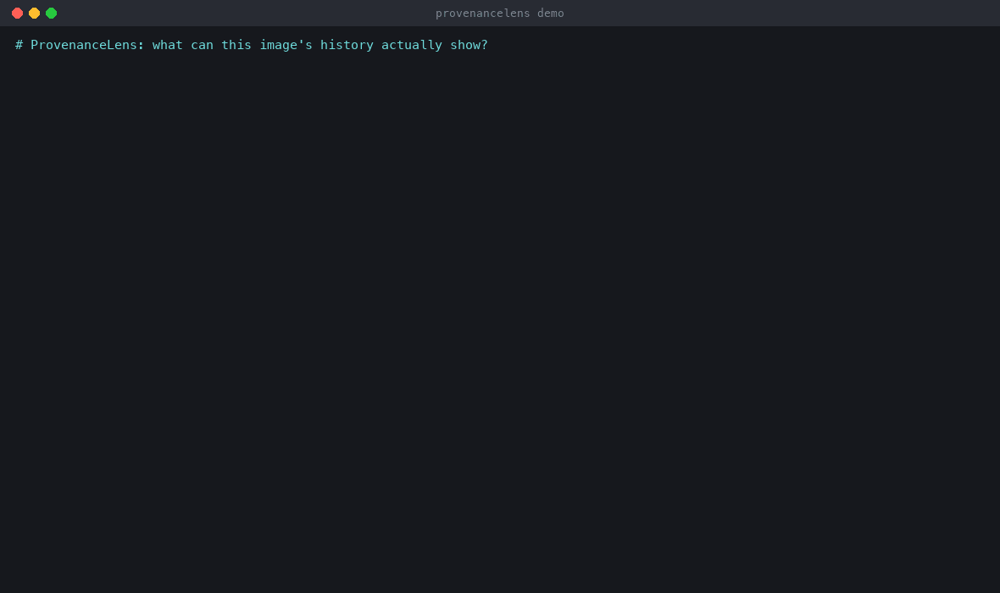
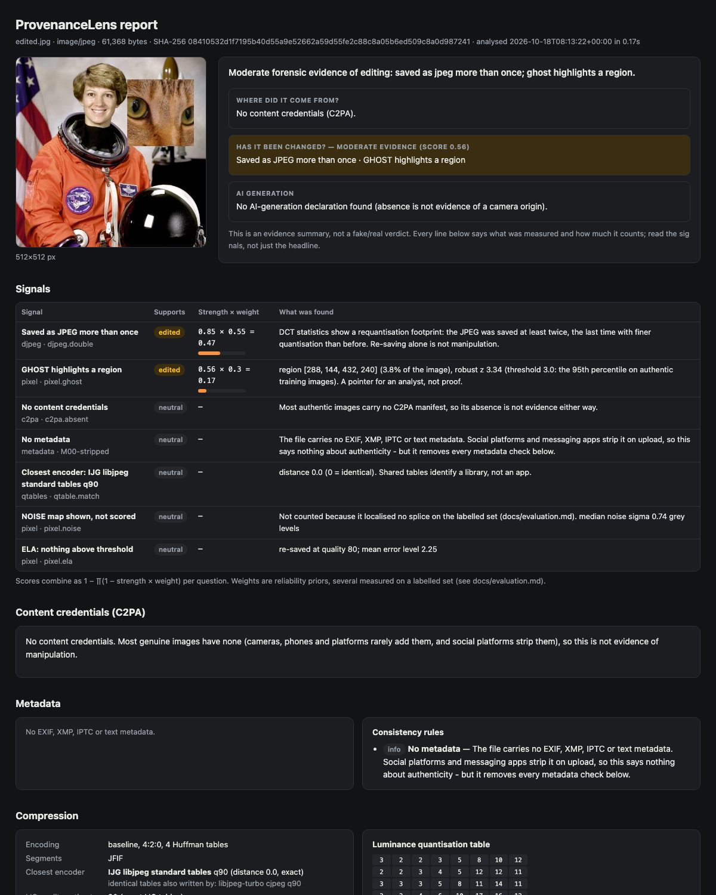
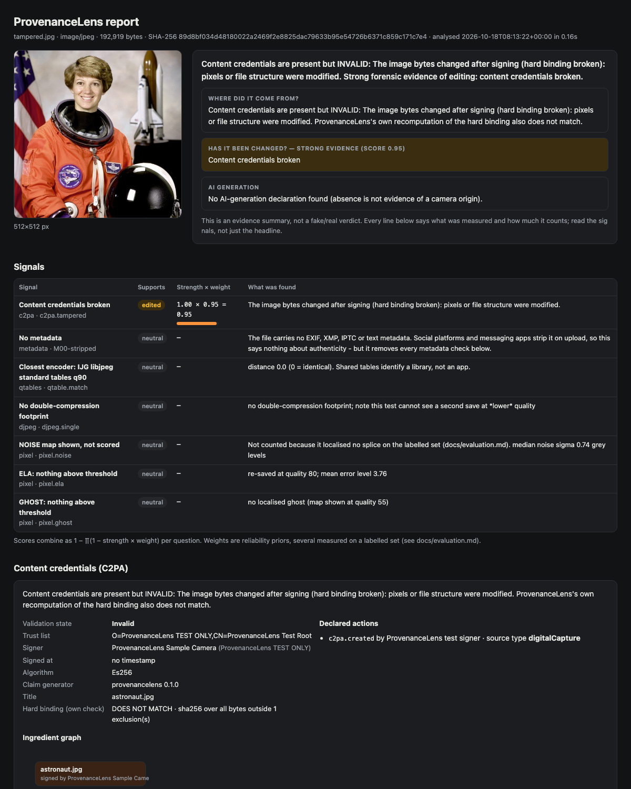

# ProvenanceLens

**An explainable media-authenticity verifier.** Give it an image (or an MP4/MOV) and it answers three questions with evidence you can check:

1. **Where did it come from?** It validates C2PA content credentials: signature, certificate chain, trust list, hard binding and ingredient history. Every status code gets a plain-English explanation.
2. **Has it been changed?** It runs metadata consistency rules, quantisation-table fingerprinting, a calibrated double-JPEG detector, ELA and JPEG-ghost maps.
3. **Is AI generation declared?** It reads C2PA source types, IPTC fields and generator parameters. It deliberately does not guess.

It never prints "fake" or "real". Each report lists every signal, what it measured, the threshold it crossed, how that threshold was set, and how much it counts.



## Examples

Five inputs, each with its full report in [`docs/samples/`](docs/samples). Open the `.html` files in a browser; they are self-contained. They are rebuilt by `python scripts/make_samples.py`.

| Input | Credentials | Editing evidence | Headline |
|---|---|---|---|
| [genuine](docs/samples/genuine.html): signed at capture | **Trusted** | none | Valid content credentials, signed by ProvenanceLens Sample Camera (trusted). No forensic evidence of editing. |
| [edited](docs/samples/edited.html): patch from another JPEG pasted in | absent | **moderate** | Saved as JPEG more than once; ghost highlights a region. |
| [tampered](docs/samples/tampered.html): the genuine file with one bit flipped | **Invalid** | strong | The image bytes changed after signing (hard binding broken). |
| [ai-labelled](docs/samples/ai-labelled.html): credentials declare `trainedAlgorithmicMedia` | Trusted | none | AI generation is declared. |
| [stripped](docs/samples/stripped.html): PNG with nothing in it | absent | none | No provenance, limited forensic signal. Nothing here supports a conclusion either way. |

| Edited: the ghost map finds the pasted patch | Tampered: one bit, explained |
|---|---|
|  |  |

## Quick start

```bash
python3.12 -m venv .venv && . .venv/bin/activate
pip install -e ".[web,dev]"

provlens analyze photo.jpg --html report.html            # console summary + HTML report
provlens analyze photo.jpg --json report.json             # machine-readable
provlens analyze photo.jpg --trust my-ca.pem              # your trust anchors: "Valid" -> "Trusted"
provlens triage ./inbox --out ./triage -j 4               # rank a folder by editing evidence
provlens serve                                            # local drag-and-drop page on 127.0.0.1:8000
```

Exit codes make it scriptable: `0` no notable evidence, `1` moderate or strong editing evidence or invalid credentials, `2` error.

| Command | What it does |
|---|---|
| `analyze FILE… [--html] [--json] [--card] [--sign-with DIR] [--trust PEM]` | Full analysis. `--card` writes a one-image summary; `--sign-with` C2PA-signs that card so the report itself has provenance |
| `triage DIR [--out] [-j N]` | Batch mode: per-file reports plus an index sorted by risk |
| `qdb list / match IMG / add IMG --source NAME / build` | Quantisation-table fingerprint DB. `add` your own phone, scanner or platform downloads |
| `evaluate [--fit]` | Rebuild the labelled set, refit thresholds, and print the held-out confusion matrices |
| `datasets fetch` | Download the pinned C2PA conformance samples into `.cache/` (blob hashes verified) |
| `testsign init DIR / sign IN OUT --id DIR [--action …] [--parent]` | Throwaway C2PA identity for tests and demos |
| `serve [--host] [--port] [--trust]` | FastAPI upload page plus `POST /api/analyze` (JSON) |

## How it works

```
input ──► sniff by magic bytes (never the extension; a mismatch is itself a signal)
   ├─► C2PA ─────► c2pa-rs validation ─► + own checks: hard-binding recomputation, JUMBF/COSE x5chain
   │                                      extraction, C2PA certificate profile, test-CA / expiry findings,
   │                                      ingredient history, plain-English status codes
   ├─► metadata ─► EXIF / XMP / IPTC / PNG text ─► 19 consistency rules (M00–M18)
   ├─► JPEG ─────► DQT tables ─► fingerprint DB (8 sources) ─► calibrated double-JPEG model
   ├─► pixels ───► ELA · JPEG ghost · noise level ─► block robust-z ─► regions
   └─► video ────► C2PA over BMFF · ffprobe container rules (V01–V06) · frame contact sheet
all signals ──► evidence model: per-question noisy-OR of (strength × weight) ──► HTML / JSON / card
```

| Module | Signal | Scored? | Weight |
|---|---|---|---|
| C2PA | binding broken / signature invalid | yes | 0.95 |
| C2PA | valid and unchanged since signing | yes (authentic) | 0.9 |
| C2PA | AI source type declared | yes (generated) | 0.95 |
| Metadata | editor named, times disagree, thumbnail differs, MakerNote missing, … | yes | 0.5–0.6 |
| Metadata | generator named, IPTC AI source type, Stable Diffusion / ComfyUI parameters | yes (generated) | 0.9 |
| Q-tables | exact Photoshop / FFmpeg tables | yes | 0.4 |
| Q-tables | standard libjpeg tables in a camera file | **no**: a genuine Nikon Z 9 file has exactly these | – |
| Double JPEG | saved twice, second save at higher quality | yes, threshold fitted | 0.55 |
| ELA, ghost | region above the fitted threshold (JPEG only) | yes | 0.3 |
| ELA + ghost | overlapping regions | yes | 0.55 |
| Noise map | region | **no**: localised 0% of splices | – |

Weights are hand-set reliability priors; thresholds and the double-JPEG model are fitted. Both are explained in [docs/evaluation.md](docs/evaluation.md).

## Evaluation

Held-out results on a labelled set split by source photo (full method, intervals and limits in [docs/evaluation.md](docs/evaluation.md)):

| Held-out kind (24 each) | none | weak | moderate | strong |
|---|---|---|---|---|
| authentic (one save) | 23 | 1 | 0 | 0 |
| platform re-upload | 24 | 0 | 0 | 0 |
| saved twice, higher quality | 0 | 3 | 21 | 0 |
| saved twice, lower quality | 20 | 4 | 0 | 0 |
| **splice** | 1 | 0 | 9 | 14 |

- **Splice vs benign:** recall 95.8% (95% CI 79.8–99.3%), specificity 100% (92.6–100%).
- **Double-JPEG flagged:** authentic 0%, platform 0%, higher-quality re-save 100%, splice 95.8%. A **lower-quality re-save is 0%**: this blind spot is stated in every report.
- **Splice localisation:** JPEG ghost 87.5%, ELA 58.3%. False alarms: ghost 8.3%, ELA 0%.
- **AI declarations** recognised 4/4. **Stripped PNGs** reported as "limited signal" 4/4.
- **All 14 C2PA conformance samples** give the expected state. The Truepic sample is explained as a loose hash exclusion, not tampering.

Calibration caught three detectors that looked fine on a headline number and were wrong underneath (a squashed double-JPEG model, ELA at its own quality, correlated "agreement"); see [§3 of the evaluation](docs/evaluation.md#3-what-calibration-changed-and-why-it-matters). Why this project has no "AI detector" is covered in the blog post: **[Why there is no reliable fake-image detector, and what to do instead](docs/why-there-is-no-reliable-fake-image-detector.md)**.

## The brief's test cases

| Test case | Where |
|---|---|
| Valid C2PA image → valid, with signer and edit history | `tests/test_spec_cases.py::test_valid_credentials_show_signer_and_history` (signed with a test CA: Trusted with `--trust`, Valid without) |
| One pixel changed → hard-binding mismatch, explained | `::test_flipped_byte_breaks_hard_binding` (one bit in the scan data; our own recomputation agrees with the SDK) |
| Phone photo vs platform re-upload → table match moves | `::test_platform_reupload_changes_quantisation_fingerprint` (Apple ImageIO via `sips` → IJG q75 after resize and re-save) |
| Spliced image → maps highlight it, double-JPEG flag raised | `::test_splice_is_localised` (4 placements; ghost or ELA region overlaps the patch) |
| Stripped image → "no provenance, limited forensic signal" | `::test_stripped_png_reports_limited_signal` |

```bash
pytest                    # 94 tests, ~5 s (fetches the pinned C2PA samples once)
pytest -m slow            # re-runs the whole evaluation and asserts the published numbers
```

To repeat the phone test with a real phone: `provlens qdb add IMG_0001.jpg --source "My phone camera"`, send the photo to yourself through a messaging app, and then run `provlens qdb match` on the downloaded copy.

## Limits

- The forensic evaluation uses synthetic manipulations on small images (≤ 320 px crops, one JPEG encoder family). Real edits are blended and retouched at 12+ megapixels. Expect different numbers on real casework.
- A missing C2PA manifest is **not** evidence of anything: most genuine images have none.
- ELA and ghost maps are pointers for an analyst, never proof.
- Metadata can be forged in minutes. Contradictions are informative; a clean result is not.
- No pixel-based AI-generation detector, by design.
- Video support is lean: credentials, container tags and sampled frames, with no frame-level forensics.
- PRNU camera fingerprinting (a stretch goal) is not implemented. Validating it honestly needs flat-field frames from real physical cameras, which this repository cannot ship.

## Layout

```
provlens/
  analyze.py      one-call pipeline → result dict          report.py / templates/   HTML report + triage page
  c2pa_check.py   validation, explanations, own checks     card.py                  summary card, optional C2PA signing
  jumbf.py        JUMBF boxes + CBOR/COSE → x5chain         evidence.py              signals and the noisy-OR verdict
  metadata.py     EXIF/XMP/IPTC extraction + rules M00–M18  evaluate.py              labelled set, fitting, held-out report
  jpeg.py         marker parser, DQT, IJG quality            server.py / cli.py       FastAPI page, command line
  qtables.py      fingerprint DB (data/qtables.json)        testsign.py              throwaway C2PA signing identity
  djpeg.py        calibrated double-JPEG detector           video.py                 MP4/MOV support
  pixel.py        ELA, noise, JPEG ghosts, heatmaps          datasets.py              pinned C2PA conformance files
docs/   evaluation.md · blog post · samples/ · demo.gif
```

## Security

Every input is treated as hostile. Each analysis stage fails into the report rather than
crashing (1,000 fuzzed files: 0 crashes, 0 hangs). Decompression bombs are refused before
decoding, and reports carry a script-free CSP. `provlens serve` is loopback-only by default, with
a Host allow-list, streaming upload limits and security headers. See [SECURITY.md](SECURITY.md)
for the details and known limits.

## Data and licences

- Code: MIT (see [LICENSE](LICENSE)).
- C2PA conformance files: [c2pa-org/public-testfiles](https://github.com/c2pa-org/public-testfiles), CC-BY-SA-4.0. They are fetched at test time and verified by Git blob hash, not redistributed. The fingerprint DB stores only the quantisation tables of three of them.
- Evaluation and sample images: scikit-image's bundled photographs (public domain / CC0).
- C2PA validation and signing: [c2pa-python](https://github.com/contentauth/c2pa-python) (c2pa-rs 0.91).
